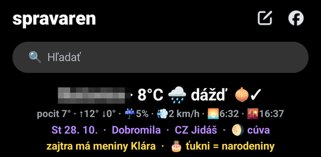

# Spravaren (messengerSlim)

A stripped-down, more private **Messenger for Android with a built-in Tor**. The build script
takes the **original Facebook APK** (your own, legally obtained copy), patches it, injects Tor
and signs it with your key. The result is one app with one icon: all Messenger traffic goes
through Tor, Facebook sees an exit node, not your IP. No Orbot.

> **This repo contains no Meta binaries.** Never commit an APK, decompiled code, keys or
> private exports here (`.gitignore` blocks them). Use only your own copy of the APK on your
> own device.

<p align="center"></p>

**In short:** your own Messenger APK, patched so that all of its traffic goes through Tor, with the
distractions removed (Stories, Reels, ads, Meta AI) and a small information panel on top of the inbox:
weather, the date with name days, birthdays, a news strip and a 🧅✓ mark that shows Tor really is in use.
The screenshot above is the top of the inbox.

Target device: Pixel 9a, Android 16, arm64. Last verified Messenger: **584.1.0.61.98**.

## Contents

1. [What it does](#what-it-does)
2. [How it works](#how-it-works)
3. [Repo layout](#repo-layout)
4. [Build](#build)
5. [Install and first run](#install-and-first-run)
6. [Panel controls](#panel-controls)
7. [Testing](#testing)
8. [New Messenger version](#new-messenger-version)
9. [Known limitations](#known-limitations)
10. [Safety and legal](#safety-and-legal)

## What it does

**Privacy and battery**

- Everything Messenger sends to the network goes through **Tor** (the bundled `libTor.so`).
- **Fail-closed**: until Tor is running the app has no network; if Tor dies midway the app is
  cut off, a packet never leaves outside Tor.
- Tor runs **only while Messenger is in the foreground**. 3 minutes after it goes to the
  background, Tor and the tunnel are torn down and the process exits. No background wake-ups
  (hence **no notifications**, by design).
- Chat-only: Stories, Reels, Marketplace, Meta AI, ads, analytics and background services are
  disabled. Calls, emoji, GIFs and photos stay.
- QUIC (UDP) is disabled in the proxygen client (photos, videos, GIFs) because Tor does not
  carry UDP; it goes straight over TCP. QUIC is **not** disabled in the DGW gateway (doing so
  caused ~49 errors/min, see `patches/no_quic.py`).

**Look and the inbox panel**

- Name **Spravaren**, the icon is the original bubble, just black. The inbox title reads
  "spravaren".
- A **panel** replaces the Stories strip: weather (city, temperature, feels-like, max/min, rain,
  wind, sunrise/sunset, rain alert within 3 h), the date with **Slovak name days**, the Czech
  name day, the moon phase and the Slovak public holiday, your people's **birthdays**, a
  scrolling strip of Slovak news and a 🧅✓ mark (verified via `check.torproject.org` that
  traffic really goes through Tor).
- Decluttered: no "Notifications are currently off" banner and no floating Meta AI button.

## How it works

The build does not hand-edit Messenger. It takes the original APK and applies **repeatable
patches**, so the process can be repeated on a new version:

```
original APK ──► Facebook signature check ──► APKEditor decode (smali)
   ──► patches/nuclear_chatonly.py   chat-only cuts
   ──► patches/no_quic.py            QUIC off
   ──► patches/branding.py           name + black icon
   ──► patches/panel_hook.py         panel hook on the Stories strip
   ──► manifest: Tor components + patches/no_background_manifest.py
   ──► tor-inject/src (Java) ──► javac + d8 ──► classesN.dex
   ──► libTor.so + libhev-socks5-tunnel.so (arm64)
   ──► APKEditor build ──► zipalign ──► apksigner (your key)
```

### Data path

```
Messenger ─► tun (VpnService, 0.0.0.0/0 except guard IPs) ─► hev-socks5-tunnel
          ─► Tor SOCKS 127.0.0.1:9050 ─► guard ─► middle ─► exit ─► Facebook
```

Everything (tunnel, SOCKS converter and Tor) runs in **a single app**, `com.facebook.orca`.
DNS goes through `mapdns` in hev (names are resolved over Tor, not by the carrier).

**Loop prevention:** Tor runs under the same UID as Messenger, so the tunnel would capture
Tor's own traffic. After startup the guard IPs are read over the ControlPort and left out of
the tunnel routes (`RouteUtil.allExcept`). Tor reaches its guard directly, everything else goes
through the tunnel.

**Kill switch:** the tunnel is built immediately at startup with the last known guards, so
Messenger has no network until Tor is up. If bootstrap stalls, the network opens briefly, just
enough for Tor to finish (the gate covers the app meanwhile), and the tunnel is rebuilt right
away. A watchdog cuts the app off if Tor crashes.

**Panel without touching Messenger:** the Java code is added as a new dex, and the only smali
change is one `invoke-static` in the Stories strip factory. `panel_hook.py` finds that factory
**by code shape**, not by obfuscated name, so it keeps working across versions.

### Injected components (`tor-inject/src`)

| Class | Role |
|---|---|
| `tor/OrcaTorVpnService` | VpnService: tunnel without guards, kill switch, watchdog, new circuit |
| `tor/TorController` | starts `libTor.so`, bootstrap, guards via ControlPort, `torrc` |
| `tor/RouteUtil` | `0.0.0.0/0` without the guard IPs |
| `tor/LifecycleWatcher` | Tor on in the foreground, off after 3 min in the background |
| `tor/TorBootProvider` | process-start hook, no second icon |
| `tor/TorGate`, `TorStatus` | the "Connecting to Tor…" bar and state shared between processes |
| `tor/ConsentActivity` | one-time VPN consent |
| `panel/WeatherPanel` | panel: weather, calendar, news, Tor mark |
| `panel/Birthdays` | birthdays (local), name days by name |
| `panel/Declutter` | inbox cleanup, the "spravaren" title |
| `hev/htproxy/TProxyService` | JNI class for `libhev-socks5-tunnel.so` |

The native libraries are **not in git**; `build-all.sh` downloads or compiles them:
`libTor.so` (Tor expert bundle 15.0.26) and `libhev-socks5-tunnel.so`
([hev-socks5-tunnel](https://github.com/heiher/hev-socks5-tunnel), pinned commit; the build
fails if `mapdns` is missing or the JNI does not match).

## Repo layout

```
README.md
docs/
  REQUIREMENTS-AND-TESTS.md   requirements (R*, P*, X*, S*), test protocol, results
patches/                      Python patches (smali and manifest) + cut data
  nuclear_chatonly.py         chat-only cuts; the lists live in cuts.json
  cuts.json                   targets, rules and whitelists of the cuts
  no_quic.py                  QUIC off
  no_background_manifest.py   no background wake-ups
  branding.py                 the "Spravaren" name + black icon
  panel_hook.py               panel hook on the Stories strip
tor-inject/
  build-all.sh                the whole build in one command
  manifest-inject.xml         Tor components for the manifest
  src/                        Java code injected into the APK
  test/                       panel logic test on the PC (run.sh)
tools/
  find_quic.py                finds where QUIC is enabled in decompiled Messenger
.github/workflows/build-apk.yml   build in GitHub Actions
```

## Build

You need: Linux, **JDK 17**, the Android SDK (build-tools + platforms), **NDK r27**
(`ndk-build`), Python 3 with **Pillow** (`pip install pillow`), `curl`, `git`, `zip`.

### Locally

```bash
IN_APK=messenger.apk \
KEYSTORE=spravaren.keystore KS_PASS=password \
ANDROID_HOME=~/Android/Sdk \
ANDROID_NDK=~/Android/Sdk/ndk/27.3.13750724 \
bash tor-inject/build-all.sh          # -> tor-inject/spravaren-signed.apk
```

| Variable | Meaning |
|---|---|
| `IN_APK` | the **original** Messenger APK (Facebook's signature is verified) |
| `KEYSTORE`, `KS_PASS`, `KS_ALIAS` | your signing key (`KS_ALIAS` defaults to `spravaren`) |
| `ANDROID_HOME`, `ANDROID_NDK` | SDK and NDK |
| `OUT_APK`, `CACHE` | optional: output file and folder for downloaded tools |

Make a key with e.g. `keytool -genkeypair -keystore spravaren.keystore -alias spravaren
-keyalg RSA -keysize 4096 -validity 36500`. **Always use the same key**: a new version then
installs over the old one and you stay logged in.

### GitHub Actions

1. In the repo set *Settings → Secrets and variables → Actions*:
   `SIGNING_KEYSTORE_B64` (`base64 -w0 spravaren.keystore`), `SIGNING_KEYSTORE_PASS`
   and optionally `SIGNING_KEY_ALIAS`.
2. *Actions → Build Spravaren APK → Run workflow* and paste a **direct link to the original
   APK**.
3. The finished APK is the run's `spravaren-apk` artifact (kept 1 day, ~10 min build).

> In a **public** repo anyone signed in to GitHub can download the artifact. If that bothers
> you, keep the repo private.

## Install and first run

**From the phone (no PC):** download the artifact (it is a ZIP, unpack it in the *Files* app),
tap the APK, allow installs from that source and on the Play Protect prompt choose *Install
anyway*.

**Via adb:**

```bash
adb install -r spravaren-tor-signed.apk
adb shell appops set com.facebook.orca ACTIVATE_VPN allow   # pre-allows the VPN
```

- The first time, Android asks for **VPN permission** (Tor runs through it): confirm OK. If you
  deny it, the app has no network; grant it with the `appops` command above.
- A build signed with a **different key** than the app on the phone will not install over it
  (Android reports a package conflict). Then uninstall the old one; **you lose the login**.
- **Logging in over Tor:** Facebook blocks some exit nodes. If the captcha does not load or
  login fails, close the app, wait ~3 minutes (the 🔑 disappears from the status bar) and try
  again, you get a different exit.

## Panel controls

| Gesture | What it does |
|---|---|
| tap the date / info row | birthday list (**Add**) |
| tap a card in the list | edit (name + day / month / year wheels) |
| long-press a card | delete |
| tap the weather row | refreshes weather and news |
| long-press the panel | **new Tor circuit** (new exit IP), a bubble shows the result |
| pull the list down | All / Unread / Groups filters (Messenger's own behaviour) |

Birthdays are **only on the phone** (`SharedPreferences`), nothing is sent anywhere. From the
names the panel also finds name days (Slovak calendar, otherwise Czech), so for "Miška
(Michaela)" it shows the name day too. A birthday reminder appears in the panel when you open
the app; notifications are off by design.

## Testing

**Panel logic on the PC** (birthdays, name days, Easter, holidays, date parsing):

```bash
bash tor-inject/test/run.sh        # expected output: VSETKO OK
```

**On the phone:** the test protocol (T1–T23), the requirements and the latest results are in
[`docs/REQUIREMENTS-AND-TESTS.md`](docs/REQUIREMENTS-AND-TESTS.md). Test only **in a chat with
yourself**, never in chats with other people (every opened chat sends a "seen").

Useful commands:

```bash
adb logcat -s OrcaTor:*                       # Tor and tunnel state
adb shell ip addr show tun0                   # the tunnel (198.18.0.1)
adb shell dumpsys activity top | less         # the real view hierarchy (Litho)
```

## New Messenger version

The patches are written to survive a version change, but obfuscation changes. Procedure:

1. Try the build with the new APK. The scripts fail **loudly** (assert), not silently:
   `panel_hook.py` expects exactly one Stories strip factory, `no_quic.py` and hev have their
   own checks.
2. If `panel_hook.py` does not find the factory, look at the new APK's smali: it looks for a
   static `(Context)` method returning a wrapper around a `RecyclerView`
   (`<init>(Context, RecyclerView)`).
3. If something in the thread breaks (photos, emoji, history), look at `MSG_WHITELIST` and
   `MEDIA_WHITELIST` in `patches/nuclear_chatonly.py` and the lists in `patches/cuts.json`.
4. `tools/find_quic.py` finds where QUIC is enabled, should that change.

## Known limitations

- **No notifications** while the app is closed. Messages load once you open it. This is the
  price of "nothing wakes up in the background".
- Contacts are not synced (the sync adapter and authenticator are disabled).
- Facebook blocks some Tor exit nodes (login, captcha). A new circuit or waiting helps.
- **Stickers** do not load (the card stays on empty squares, no error in the log). GIFs and
  emoji work. The cause is not confirmed.
- If Tor's bootstrap does not catch within 90 s, the gate offers a retry; the network stays
  closed until then.
- Works on **arm64** only.

## Safety and legal

- Use only your **own APK** on your **own device**. Never upload a modified APK or Meta code to
  GitHub.
- Never commit the signing key or its password (`*.keystore`, `*.jks` are in `.gitignore`).
- Spravaren is an unofficial modification; Meta does not support it and may block the account.
