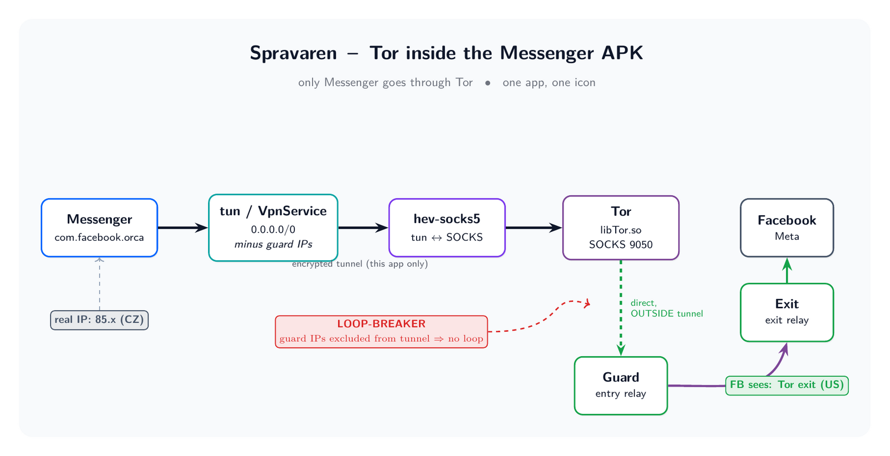
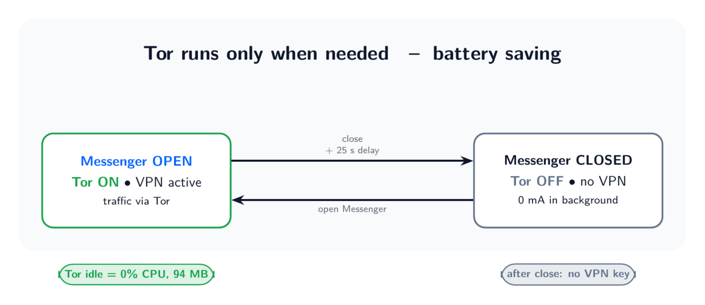

<div align="center">

# 🧅 messenger-slim · Spravaren

**A slimmed, privacy-hardened Messenger build from your own legally obtained APK —
with Tor baked directly into the app.**

Only Messenger goes through Tor. One app, one icon. No Orbot.

</div>

> ⚠️ This repository contains **no** Facebook/Meta binaries.
> Do not commit APKs, decompiled sources, keys, or proprietary assets.
> Use only your own legally obtained APK copy for local experimentation, on your own device.

---

## What's inside

1. **[`tor-inject/`](tor-inject/) — Tor inside the Messenger APK.** Injects a Tor +
   SOCKS tunnel straight into `com.facebook.orca` so the real Messenger routes itself
   through Tor. Facebook sees a Tor exit, not your IP.
2. **`scripts/` — the slim cut workflow.** PowerShell patch sets that no-op Messenger
   features (Stories, Reels, Marketplace, Meta AI, background services) for a chat-only,
   low-battery build.

---

# 🧅 Part 1 — Tor inside the APK



```
Messenger → tun (VpnService, 0.0.0.0/0 MINUS guard IPs) → hev-socks5-tunnel
         → Tor SOCKS 127.0.0.1:9050 → guard (direct) → exit → Facebook
```

- **Hook without editing Messenger smali:** an injected `<provider>` (`TorBootProvider`)
  runs at process start and registers a `LifecycleWatcher`.
- **DNS through Tor:** hev `mapdns` (SOCKS resolve-by-name) — no Tor UDP needed.

### 🔑 Loop-breaker — why it works at all

Tor runs under the **same UID** as Messenger. If the tunnel captured *everything*, it
would capture Tor's own traffic too → infinite loop. Fix: Tor bootstraps first, its
**guard-node IPs** are read via the **ControlPort**, and those IPs are **excluded from
the tunnel routes** (`RouteUtil.allExcept`). Tor's traffic to the guard goes direct;
Messenger goes through the tunnel. `ClientUseIPv6 0` keeps guards on IPv4, so IPv6 is
routed entirely into the tunnel.

### 🛡️ Kill-switch (fail-closed)

So not a single packet escapes Tor at startup:

- On start the tunnel is built **immediately**, excluding the **last-known guards**
  (cache `guards.txt`) → Messenger **has no network until Tor is up**. No startup leak.
- **Fallback:** if bootstrap stalls (new guard / stale consensus), the network opens
  briefly so Tor can finish, then the tunnel is rebuilt.
- **Watchdog:** if Tor dies mid-session → Messenger is **blackholed** (loses network),
  never leaks.

### 🔋 Battery — Tor runs only when needed



`LifecycleWatcher` turns Tor on only while Messenger is in the **foreground** and off
~25 s after it goes to the **background**.

| | Tor always on | **Tor only when needed** (this build) |
|---|---|---|
| Background drain | constant (VPN + Tor) | **zero** — Tor OFF |
| Tor idle | 0% CPU, 94 MB | 0% CPU, 94 MB (only while in use) |
| Background notifications | yes | no (push rides the tunnel) |

> Trade-off: because Tor stops on close, messages arrive only once you open Messenger.

### 🧩 Injected components

| File | Role |
|---|---|
| `OrcaTorVpnService` | VpnService: guard-excluded tunnel, kill-switch, watchdog |
| `TorController` | starts `libTor.so`, async bootstrap, guard IPs via ControlPort, guard cache |
| `RouteUtil` | `0.0.0.0/0` MINUS guard IPs (loop-breaker) |
| `LifecycleWatcher` | Tor ON in foreground / OFF in background (battery) |
| `TorBootProvider` | startup hook inside Messenger (no second launcher) |
| `ConsentActivity` | one-time VPN consent |
| `hev/htproxy/TProxyService` | JNI class for `libhev-socks5-tunnel.so` |

**Native libraries** (not in git — fetched/built by `build.sh`): `libTor.so`
(tor-expert-bundle), `libhev-socks5-tunnel.so` (NDK build of
[hev-socks5-tunnel](https://github.com/heiher/hev-socks5-tunnel)).

### ✅ Verified on device (Pixel 9a)

| | IP | Location |
|---|---|---|
| **Real network** (no Tor) | `[redacted-ip]` | [redacted-location] |
| **What Facebook sees** | `[redacted-ip]` (IsTor:true) | New York, USA |

Messenger connects **only to `127.0.0.1:9050` (Tor)** — no direct Facebook connections.
Meta sees the Tor exit, not you.

**Check it yourself:** a browser at `check.torproject.org` shows *"not Tor"* (correct —
the phone isn't on Tor, only Messenger). Or FB → *Settings → Where you're logged in* →
shows the Tor exit's country.

### 🔨 Build (Linux, arm64-v8a)

See [`tor-inject/build.sh`](tor-inject/build.sh). Needs JDK 17, Android SDK
(build-tools + platform-35), NDK, [APKEditor](https://github.com/REAndroid/APKEditor):

1. `APKEditor d -dex` decompiles the APK (raw dex; sidesteps the apktool aapt2 bug).
2. `javac` + `d8` → `classes14.dex` from `tor-inject/src/`.
3. Add `classes14.dex` + `libTor.so` + `libhev-socks5-tunnel.so`; insert
   `tor-inject/manifest-inject.xml` before `</application>`.
4. `APKEditor b` → `zipalign` → `apksigner` (debug keystore).

Diagrams: `tor-inject/docs/*.tex` (TikZ) → `lualatex` → `*.png`.

### 📲 Install

```bash
adb uninstall com.facebook.orca        # FIRST time: re-sign ≠ FB signature → login is lost
adb install --no-incremental orca-tor-signed.apk
adb shell appops set com.facebook.orca ACTIVATE_VPN allow   # pre-grant VPN consent
```

Later updates with the same debug key: `adb install -r ...` (login preserved).

### ⚠️ Known limitation

Facebook **blocks Tor exit nodes** — login/connect through some exits fails
(*"unable to log in"*). Retry, or pin an exit: `ExitNodes {us}` in `torrc`. This is
Meta's policy, not a bug in the injection.

---

# ✂️ Part 2 — The slim cut workflow

Local-only PowerShell workflow that patches a slimmed Messenger build from your own APK.

- **Target:** Messenger `550.0.0.45.63` · Platform: Windows (PowerShell)

### Scripts

| Script | Purpose |
|---|---|
| `scripts/prepare-workspace.ps1` | create working folders, check tools |
| `scripts/decompile.ps1` | decompile your local APK with apktool |
| `scripts/apply-ai-cuts.ps1` | no-op AI entrypoints |
| `scripts/apply-nonai-cuts.ps1` | no-op Reels / Marketplace / Stories / search extras |
| `scripts/apply-battery-cuts.ps1` | no-op non-core background receivers/services |
| `scripts/apply-chatonly-extreme.ps1` | strict chat-only cuts |
| `scripts/rebuild-sign.ps1` | rebuild + sign (debug key by default) |
| `config/features-to-disable.json` | patch-intent checklist |

### Prerequisites

Java 17+, `apktool` (or `tools/apktool.jar`), Android build-tools (`zipalign`,
`apksigner`). `zipalign`/`apksigner` are auto-detected from
`%LOCALAPPDATA%\Android\Sdk\build-tools\*` if not on PATH.

### Quick start

1. Put your legally obtained APK in `input/messenger-550.0.0.45.63.apk`.
2. `./scripts/prepare-workspace.ps1` → `./scripts/verify-apk.ps1` → `./scripts/decompile.ps1`
3. Edit code/resources in `work/decompiled`.
4. `./scripts/rebuild-sign.ps1` → `output/messenger-550.0.0.45.63-signed.apk`

### no-res workflow (for problematic APK resources)

If a regular resource rebuild fails on this APK, work in `work/decompiled_nres` and apply
the patch set there (`apply-ai-cuts.ps1 -Level core|extended|aggressive`,
`apply-nonai-cuts.ps1 -Level …`, `apply-battery-cuts.ps1`, `apply-chatonly-extreme.ps1`),
then rebuild/sign from `work/decompiled_nres`.

---

## Safety & legal

- Never upload patched APKs or Meta binaries to GitHub.
- Keep all modification output local; test on your own device only.
- Use only a legally obtained APK copy (e.g. your own device backup/export).
